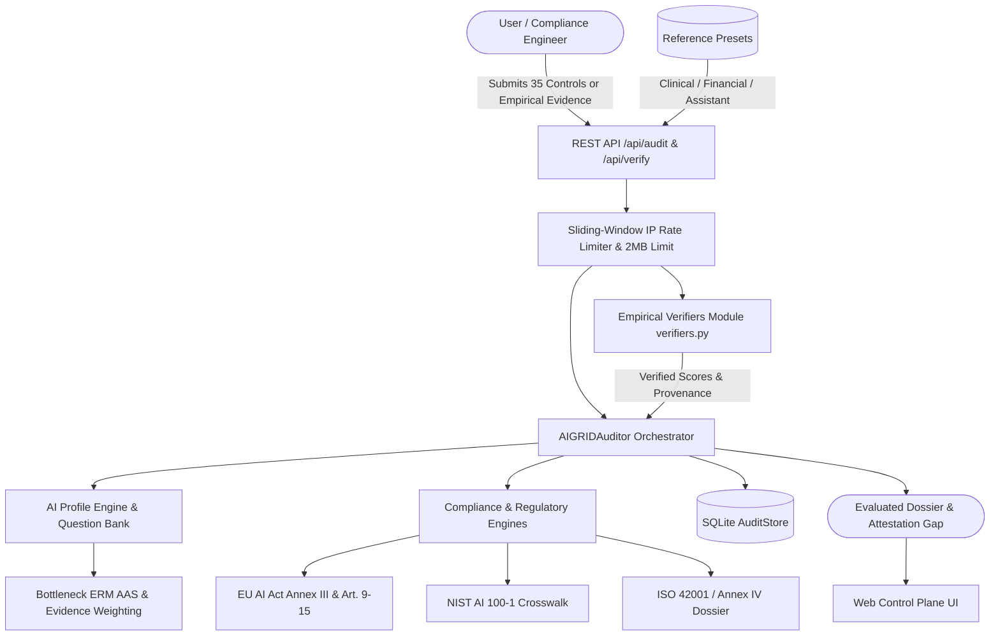

# AI-GRID Architecture & Technical Specification (v5.0.0)

## 1. System Overview

AI-GRID is a high-assurance AI Governance, Risk, and Compliance (GRC) evaluation control plane.
It provides structured, evidence-based technical assessments grounded in:
- **QB4AIRA Taxonomy** (Lee et al., IEEE Software 2024)
- **EU AI Act** (Regulation (EU) 2024/1689: Articles 9 to 15 & Annex III)
- **NIST AI 100-1** (AI Risk Management Framework 1.0)
- **ISO/IEC 42001** (Artificial Intelligence Management System)

---

## 2. The 7 Canonical Trust Dimensions & 35 Technical Controls

AI-GRID organizes technical assessment across 7 canonical trust dimensions (5 technical controls per dimension = 35 total controls):

1. **Security & Robustness** (`q1_adversarial_testing` to `q5_rate_limiting_auth`):
   - Adversarial perturbation testing, concept drift monitoring, AI-BOM supply chain inventory, red-teaming, rate limiting.
2. **Fairness & Non-Discrimination** (`q6_demographic_parity` to `q10_fairness_audit`):
   - Demographic parity, class representation balance, coverage adequacy, training volume sufficiency, empirical disparate impact audits.
3. **Transparency & Explainability** (`q11_xai_implementation` to `q15_uncertainty_bounds`):
   - Prediction attribution telemetry, quantitative feature weighting, plain-language reasoning summaries, Model Cards, uncertainty intervals.
4. **Privacy & Data Governance** (`q16_encryption_rest` to `q20_governance_policy`):
   - AES-256 encryption at rest, TLS 1.3 transit encryption, automated data retention/purging, automated PII redaction, governance charters.
5. **Human Oversight & Agency** (`q21_hitl_gates` to `q25_override_records`):
   - Mandatory Human-in-the-Loop decision gates, operational autonomy constraints, immediate kill-switches, operator training, intervention logging.
6. **Accountability & Governance** (`q26_incident_escalation` to `q30b_governance_charter`):
   - Incident response SLAs, tamper-evident append-only cryptographic logging, technical compliance dossiers, post-market monitoring, accountability frameworks.
7. **Safety & Reliability** (`q31_input_validation` to `q35_failure_mode_testing`):
   - Input schema validation & corrupted data rejection, active multi-tier guardrails, deterministic output clamping, contextual safety advisories, failure-mode testing.

---

## 3. Mathematical Scoring Model: Bottleneck ERM & Evidence Weighting

Composite assurance cannot rely on an arithmetic mean because strong pillars mask critical security, fairness, or safety vulnerabilities.
AI-GRID computes the **Assurance Adequacy Score (AAS)** using a convex combination of the dimension average $\bar{S}$ and the bottleneck minimum $\min(S)$:

$$\text{AAS}(\alpha) = \alpha \cdot \bar{S} + (1 - \alpha) \cdot \min_{d \in \{1 \dots 7\}} S_d$$

- **Default Sensitivity Parameter**: $\alpha = 0.60$ (Balances systemic maturity with single-point failure safeguarding).
- **Dimension Score Formulation**:
  $$S_d = 100 \times \frac{\sum_{i=1}^{n_d} w_i \cdot s_i \cdot w_{\text{evidence}, i}}{\sum_{i=1}^{n_d} w_i \cdot w_{\text{evidence}, i}}$$
  where:
  - $s_i \in [0.0, 1.0]$ is the fulfillment score for item $i$.
  - $w_i = 1.0$ is the uniform control weighting.
  - $w_{\text{evidence}, i}$ reflects the verification tier:
    - **Tier T1 ($w=1.0$)**: Verified empirical artifact (e.g. uploaded predictions CSV, CycloneDX SBOM, TLS handshake, cryptographic hash chain).
    - **Tier T2 ($w=0.8$)**: Structured technical documentation and third-party audit reports.
    - **Tier T3 ($w=0.6$)**: Subjective self-attestation via questionnaire.

### Attestation Gap Analysis

When an audit incorporates verified evidence, AI-GRID quantifies the **Attestation Gap** between self-reported claims and verified results:

$$\Delta_d = S_{d, \text{claimed}} - S_{d, \text{verified}}$$
$$\Delta_{\text{AAS}} = \text{AAS}_{\text{claimed}} - \text{AAS}_{\text{verified}}$$

A positive gap ($\Delta > 0$) reveals governance over-claiming, preventing compliance sign-off based solely on unverified self-attestation.

---

## 4. Empirical Verification Modules (`verifiers.py`)

AI-GRID provides 5 empirical verification endpoints (`POST /api/verify/<module>`):

| Module | Target Endpoint | Checked Item | Input Formats | Scoring Thresholds |
|:---|:---|:---|:---|:---|
| **Fairness** | `/api/verify/fairness` | `q10_fairness_audit` (Fairness) | CSV (`protected_attribute`, `y_true`, `y_pred`) | **1.0**: $\text{DIR} \ge 0.80$ and $|\text{SPD}| \le 0.10$ **0.5**: $\text{DIR} \ge 0.70$ and $|\text{SPD}| \le 0.15$ **0.0**: otherwise |
| **Dependencies** | `/api/verify/dependencies` | `q3_aibom_inventory` (Security) | CycloneDX JSON SBOM or `requirements.txt` | **1.0**: CycloneDX with no CVSS $\ge 7.0$ match in CVE database **0.5**: Valid CycloneDX with high CVE or `requirements.txt` only **0.0**: Failed parse or critical vulnerability |
| **TLS** | `/api/verify/tls` | `q17_encryption_transit` (Privacy) | JSON payload (`host`, `port`) | **1.0**: TLS 1.3 + valid non-expired certificate **0.6**: TLS 1.2 + valid certificate **0.0**: Older protocol, expired cert, or unreachable |
| **Log Integrity** | `/api/verify/log-integrity` | `q27_tamper_evident_logs` (Accountability) | JSONL (`prev_hash`, `data`, `hash`) | **1.0**: Valid SHA-256 chain from genesis (`GENESIS` or 64 zeros) **0.0**: Broken hash chain, altered entry, or missing link |
| **Robustness** | `/api/verify/robustness` | `q1_adversarial_testing` (Security) | CSV with clean & perturbed predictions | **1.0**: Accuracy degradation $\Delta \text{Acc} \le 0.05$ (&le; 5%) **0.5**: Accuracy degradation $\Delta \text{Acc} \le 0.15$ (&le; 15%) **0.0**: Accuracy drop > 15% |

### Security Safeguards in Verifiers:
- **SSRF Protection**: `verify_tls` strictly restricts ports to 443 and 8443, enforces a 5-second timeout, and validates resolved IP addresses to block private (RFC 1918), loopback (`127.0.0.0/8`), link-local (`169.254.0.0/16`), cloud metadata (`169.254.169.254`), multicast, and unspecified (`0.0.0.0`) destinations.
- **TLS Probing Rate Limit**: Strict rate limiting of 5 requests per minute per IP on `/api/verify/tls`.
- **Zero Arbitrary Execution**: Strict reliance on Python standard library (`csv`, `json`, `ssl`, `hashlib`, `ipaddress`). Model weights, pickle loading, `eval()`, and `exec()` are forbidden.

---

## 5. Regulatory Crosswalk Architecture

### EU AI Act (Regulation (EU) 2024/1689)
- **Legal Risk Classification**: Purely domain-driven based on intended purpose (Annex III High-Risk vs Article 5 Prohibited vs Article 50 Limited vs Minimal). Risk classification is strictly independent of audit scores.
- **Article 11 (Technical Documentation)**: Evaluated as $\text{mean}(S_{\text{Transparency}}, S_{\text{Accountability}})$.
- **Article 12 (Record-Keeping & Logging)**: Evaluated directly against the **Accountability & Governance** dimension score.
- **Articles 9, 10, 13, 14, 15**: Evaluated against Risk Management, Data Governance, Transparency, Human Oversight, and Accuracy/Robustness/Cybersecurity.

### NIST AI 100-1 (AI Risk Management Framework)
- **Core Functions**: Crosswalked across **GOVERN, MAP, MEASURE, MANAGE**.
- **Accountability Wiring**:
  - `GOVERN 2.1` directly reflects `acct_score`.
  - `MEASURE 2.5` and `MANAGE 4.1` incorporate `acct_score`.
  - The composite `GOVERN` function average includes `acct_score` alongside transparency, oversight, privacy, safety, and security.

---

## 6. Persistence & Deployment Security

1. **Persistence Layer (`audit_store.py`)**:
   - Stored in SQLite database (`data/aigrid_audits.db`).
   - Tables: `audits` (metadata, AAS, dossier), `audit_evidence` (verified and self-reported evidence items with tier, metric details, and verification timestamps), and `audit_findings` (prioritized remediation findings).
2. **Unauthenticated Local/Demo Deployment**:
   - AI-GRID operates without API keys or session cookies. It is engineered for local development, research benchmarking, and demonstration environments.
   - Do not deploy to unsegmented public networks or ingest sensitive patient/consumer PII.
3. **Upload Constraints**:
   - Strict 2 MB payload size limit (`MAX_CONTENT_LENGTH = 2 * 1024 * 1024`).
   - Allowed file extensions: `.csv`, `.json`, `.txt`, `.jsonl`.
4. **Information Leakage Prevention**:
   - Audit history endpoints (`/api/audit/history` and `/api/audit/<id>`) return metadata summaries (ID, model name, timestamp, AAS, trust grade, bottleneck) and sanitize raw stored responses.
